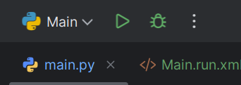
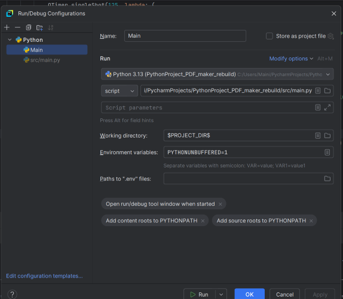
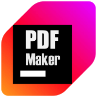
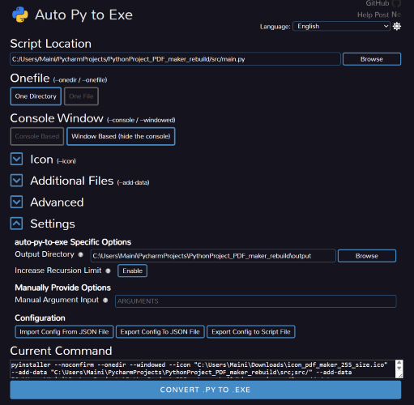
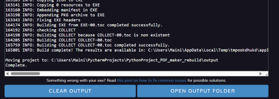
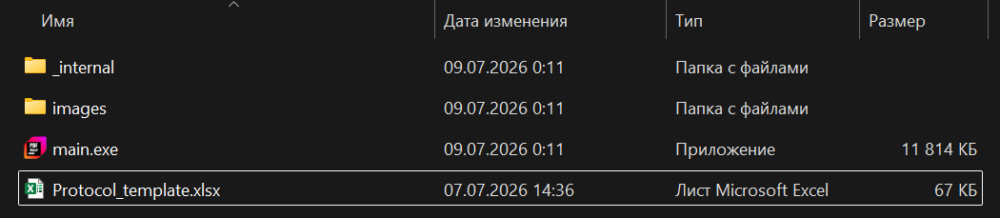

# PDF_maker
## Формирование протоколов на основе парсинга документов
___
### Для работы программы необходимо:
- **Python 3.8+**
- **Windows 10(11)**
- **предустановленный Microsoft Excel**
___
Программа автоматизирует подготовку протоколов заседания комиссии по приёму кандидатских экзаменов и состоит из 3 вкладок:
## 1) Формирование PDF на основе готового протокола и шаблона
#### Исходные данные:
    - Файл Excel с двумя листами:
  - **Протокол** – шаблон протокола с полями для заполнения.
  - **БД** – строки с персональными данными: каждая строка соответствует одному человеку.
### Задача
Автоматизировать заполнение полей листа «Протокол» для каждого человека из листа «БД» и сохранение результата в отдельный PDF-файл.
### Алгоритм работы
1. Нажать "Выбрать файл"
2. В открывшимся окне выбрать excel файл, содержащий 2 листа:
    - Протокол: шаблон с полями для заполнения
    - БД: таблица, содержащая информацию, которую необходимо заполнить в шаблон
3. При необходимости нажать "Изменить путь для сохранения" и указать новый путь в появившимся окне. Текущий путь отображается правее надписи "Путь сохранения:"
4. Нажать на белую кнопку в виде стрелочки в правом верхнем углу
5. Дождаться окончания работы программы. Прогресс отображается в прогрессбаре. По окончании высветится уведомление.
6. Нажать "Открыть папку с PDF", чтобы перейти к сгенерированным PDF на диске.
## 2) Формирование PDF на основе архива документов
#### Исходные данные:
    - Excel таблица, содержащая колонки 'ФИО', `ПРОФИЛЬ`, `ГРАЖДАНСТВО` с данными студентов
    - doc файл, содержащий таблицу с ФИО комиссий и шифрами направления по истории
    - doc файл, содержащий таблицу с ФИО комиссий и шифрами направления по иностранным
    - doc файл, содержащий таблицу с ФИО комиссий и шифрами направления по специальностям
### Задача
Автоматизировать генерацию БД с 1 вкладки с последующей автоматическкой генерацией PDF файлов с протоколами
### Алгоритм работы
1. Выбрать нужный семестр (1,2,3) в левом верхнем углу, нажав на необходимый текст или прямоугольник:
    - 1 семестр: работа с doc файлом комиссии по истории
    - 2 семестр: работа с doc файлом комиссии по иностранным
    -  3 семестр: работа с doc файлом комиссии по специальностям
2. В самом верху ввести текст приказа в поле "Введите текст приказа"
(Например: "Состав комиссии (утверждён приказом ректора университета № 1/3-08 от 12 января 2026 г.")
3. Выбрать таблицу взависимости от выбранного семестра
4. Выбрать таблицу для парсинга (Excel таблица с данными студентов)
5. При желании изменить путь сохранения PDF нажав "Выбрать папку" и указать новый путь
6. Нажать "Начать парсинг и генерацию PDF" внизу
7. Дождаться окончания работы программы, прогресс отображается в прогрессбаре
## 3) Выбор темы программы
На данной вкладке можно выбрать визуальное оформление программы из 3 тем:
   - Dark
   - Violet
   - Standard

Чтобы выбрать тему, необходимо нажать по ней левой кнопкой мыши

## Для работы программы необходим установленный excel
___
# Запуск проекта в PyCharm
___
### Для запуска проекта следуйте инструкции:
#### В верхней правой части интерфейса PyCharm найдите зелёную кнопку пуска:

#### Нажмите на кнопку, открывающую выпадающий список и выберите в нём "Edit Configurations"

#### В поле Name введите название .run.xml файла запуска - теперь так будет называться файл, с которого будет запускаться проект (название появится рядом с кнопкой выпадающего списка по завершении инструкции).
#### В поле напротив script можно нажать на иконку папки и выбрать исполнительный файл, который находится в папке имя_проекта/scr/main.py
#### В поле working directory должна быть выбрана корневая папка проекта, но можете вписать формулу: $PROJECT_DIR$, как в примере на скриншоте
####  завершение инструкции нажмите кнопку Apply и Ok. Теперь у Вас должна появиться иконка созданного файла типа:

#### Запускайте проект только по этому файлу
___

# PDF_Maker_exe
Собрал проект в exe через auto-py-to-exe (иными способами - pyinstaller - не удалось, к сожалению)
___
### Для самостоятельной сборки через auto-py-to-exe сначала установите библиотеку командой в терминале PyCharm:
```bash

pip install auto-py-to-exe
```
### после установки библиотеки в проект введите в консоль следующую команду:
```bash

 auto-py-to-exe
```
### После ввода команды в консоль появится виртуальная оболочка "Auto Py To Exe". 
### Чтобы быстро собрать проект создайте в любом месте на своём диске файл с расширением .json. Скопируйте и вставьте в него следующую конфигурацию (не забудьте добавить свои пути до папки с проектами там, где это указано! Ващ путь должен иметь вид: C:/Users/Maini/PycharmProjects/PythonProject_PDF_maker_rebuild/src/main.py).
# Configuration.json:
```bash

 {
 "version": "auto-py-to-exe-configuration_v1",
 "pyinstallerOptions": [
  {
   "optionDest": "noconfirm",
   "value": true
  },
  {
   "optionDest": "filenames",
   "value": "!допишите свой путь от диска до папки с проектами!/PycharmProjects/PythonProject_PDF_maker_rebuild/src/main.py"
  },
  {
   "optionDest": "onefile",
   "value": false
  },
  {
   "optionDest": "console",
   "value": false
  },
  {
   "optionDest": "icon_file",
   "value": "!допишите свой путь от диска до папки с проектами!/PycharmProjects/PythonProject_PDF_maker_rebuild/images/icons/icon_pdf_maker_255_size.ico"
  },
  {
   "optionDest": "clean_build",
   "value": false
  },
  {
   "optionDest": "strip",
   "value": false
  },
  {
   "optionDest": "noupx",
   "value": false
  },
  {
   "optionDest": "disable_windowed_traceback",
   "value": false
  },
  {
   "optionDest": "uac_admin",
   "value": false
  },
  {
   "optionDest": "uac_uiaccess",
   "value": false
  },
  {
   "optionDest": "argv_emulation",
   "value": false
  },
  {
   "optionDest": "bootloader_ignore_signals",
   "value": false
  },
  {
   "optionDest": "datas",
   "value": "!допишите свой путь от диска до папки с проектами!/PycharmProjects/PythonProject_PDF_maker_rebuild/src;src/"
  },
  {
   "optionDest": "datas",
   "value": "!допишите свой путь от диска до папки с проектами!/PycharmProjects/PythonProject_PDF_maker_rebuild/images;images/"
  },
  {
   "optionDest": "datas",
   "value": "!допишите свой путь от диска до папки с проектами!/PycharmProjects/PythonProject_PDF_maker_rebuild/Protocol_template.xlsx;."
  },
  {
   "optionDest": "hiddenimports",
   "value": "pandas"
  },
  {
   "optionDest": "hiddenimports",
   "value": "PyQt6"
  },
  {
   "optionDest": "hiddenimports",
   "value": "xlsx"
  },
  {
   "optionDest": "hiddenimports",
   "value": "requests"
  },
  {
   "optionDest": "hiddenimports",
   "value": "bs4"
  },
  {
   "optionDest": "hiddenimports",
   "value": "aspose.words"
  },
  {
   "optionDest": "hiddenimports",
   "value": "openpyxl"
  }
 ],
 "nonPyinstallerOptions": {
  "increaseRecursionLimit": true,
  "manualArguments": ""
 }
}
```
### Теперь выберите этот файл для импорта в пункте "Settings -> Configuration":

### После импорта нажмите на кнопку "CONVERT .PY TO .EXE" в нижней части окна. После завершения процесса нажмите на кнопку "OPEN OUTPUT FOLDER". Скопируйте из неё папку "main" себе на диск. 

### Важно! Для правильного отображение изображений скопируйте папку "images" из ветки "development" и вставьте в папку "main", которую Вы только что скопировали себе на диск. Таким же образом скопируйте из папки проекта файл Protocol_template.xlsx и вставьте его в папку с exe.
## Готовая папка с exe файлом должна иметь вид:

### Теперь по двойному клику на иконку exe файла у Вас должен запускаться проект.